# METATRADER-AIDER

Квантовая лаборатория стратегий для MetaTrader 5, где ИИ-ассистент Aider работает «Head of Quant Research»: автономный цикл «обучение → бэктест → оптимизация → доработка кода ассистентом» с целью пробить порог Sharpe Ratio ≥ 1.5.

## 🎯 Суть системы на словах

1. **Цель (таргет) — производная Гаусса.** В `strategy_logic.py` таргет считается как первая производная сглаженной гауссовой кривой цены (`scipy.ndimage.gaussian_filter1d`, адаптивный порог). «Учитель» не видит будущих данных: для момента T смещение `MATH_OFFSET = 4 * SIGMA` учитывает только прошлое. Логика проверена в `TabPFN-аппроксиматор*.py`.

2. **Аппроксиматор таргета.** Модель учится повторять «идеальный» таргет учителя по фичам (MACD, RSI, позиция в Bollinger, ROC, ATR, волатильность, объём, час/день недели и др.). В проекте сравнены три аппроксиматора: **LightGBM** (`LightGBM-аппроксиматор-производная-регрессор.py`), **TabPFN** (`TabPFN-аппроксиматор.py`, `-производная.py`, `-производная-BTC.py`) и **CatBoost** — по ходу истории репозитория TabPFN/torch были заменены на CatBoost как единственную боевую модель (`strategy_logic.py`).

3. **Бэктест-движок.** `fast_backtest.py` — класс `BacktestEngine`: побарная симуляция Buy/Sell, стоп по High/Low, закрытие по таймауту, фиксированный спред в каждой сделке. `compare_models.py` — прогон разных `model_type` на одних и тех же данных MT5.

4. **Оптимизация и «эволюция» стратегии.** `quantum_lab.py` — Optuna: 10 000 баров EURUSD M15, максимизация Sharpe на train; лучшие параметры сохраняются в `best_params.json`. `quantum_boss.py` — автономный босс: крутит `quantum_lab.py`, читает `last_result.txt`, и если Sharpe < 1.5 — автоматически вызывает Aider с заданием «добавь казуальные фичи, улучши таргет, побей 1.5». `ТЗ.txt` — исходное техническое задание ассистенту (4 задачи: движок, агент, авто-трейн с ансамблем из 5 моделей, анализ ошибок на OOS).

5. **Живой бот.** `bot_v8_final.py` — live-бот на EURUSD M15: контролируемое проскальзывание (`SLIPPAGE_LIMIT = 2 × SPREAD`), исполнение по тику MT5, построение эквити (`live_equity.png`); `test_equity.py` / `test_equity2.py` — проверка equity на данных MT5; `start.bat` — запуск.

## 📈 Графики эквити

| Equity curve | Equity curve (test) | Live equity |
|---|---|---|
| 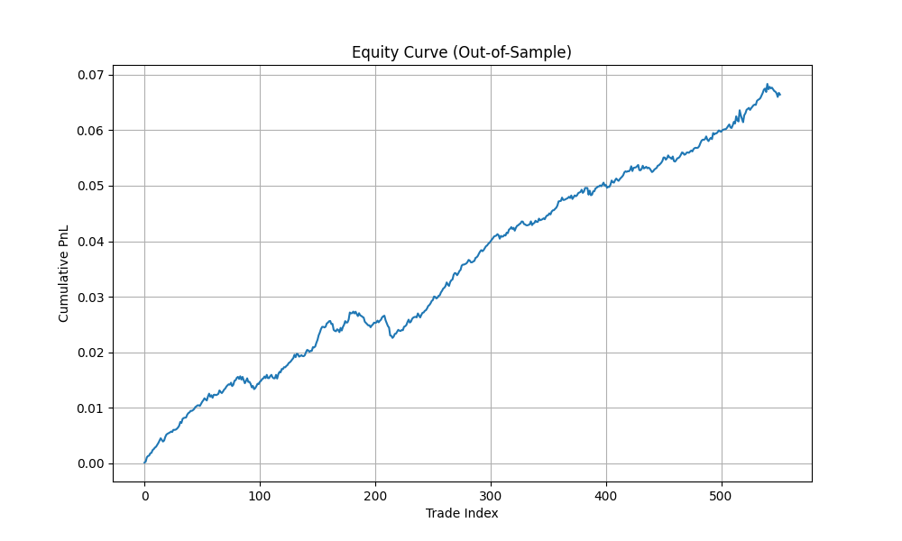 | 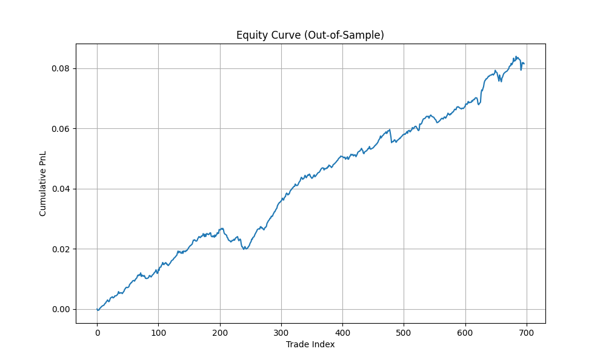 | 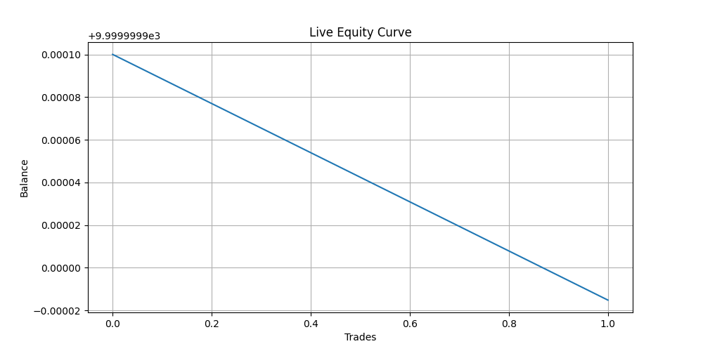 |

| TabPFN equity | TabPFN final |
|---|---|
| 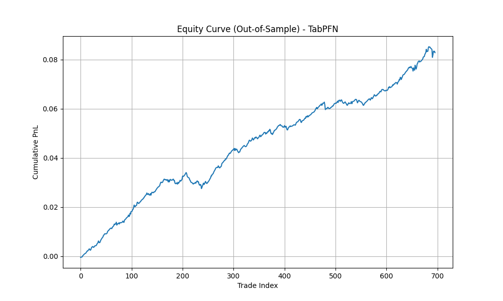 | 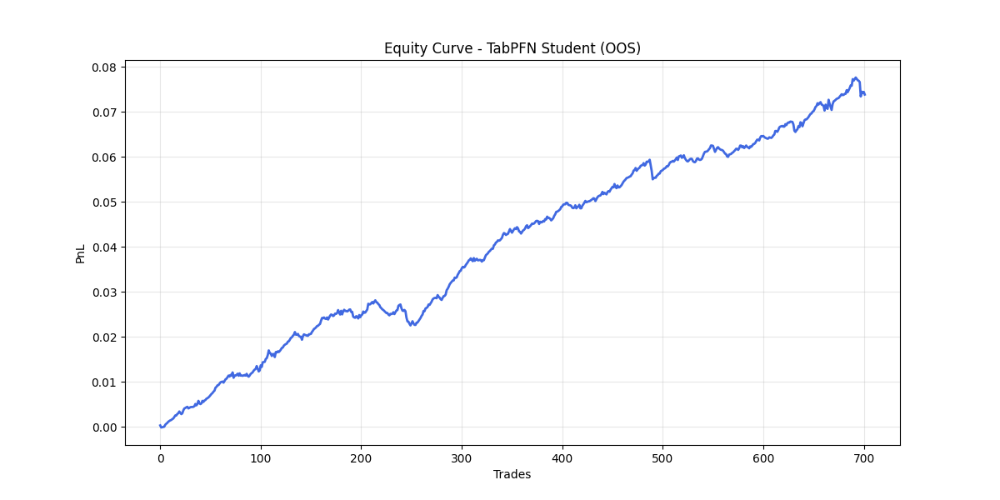 |

Сравнение аппроксиматоров (Гаусс vs модели):

| Gaussian vs LightGBM | Gaussian vs TabPFN |
|---|---|
| 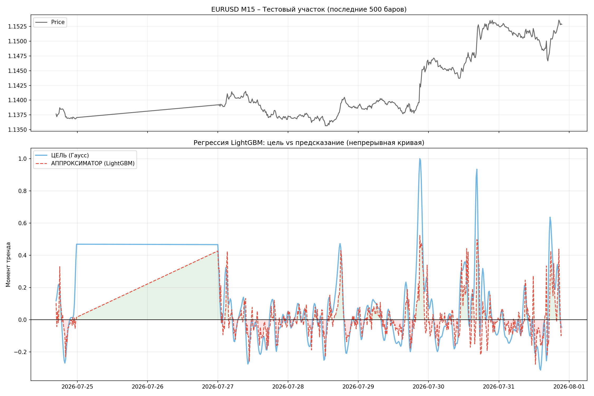 | 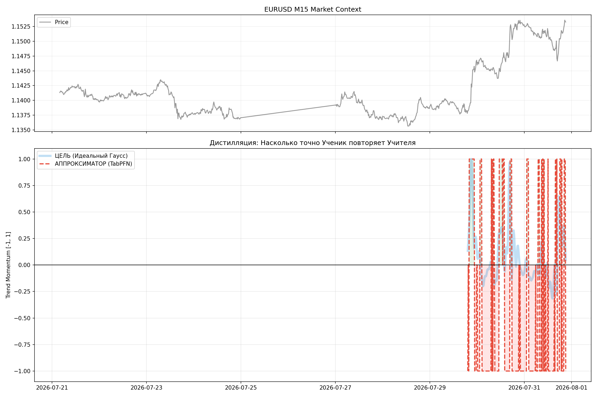 |

| Gaussian vs TabPFN (full test) | Gaussian vs approx (continuous) |
|---|---|
| 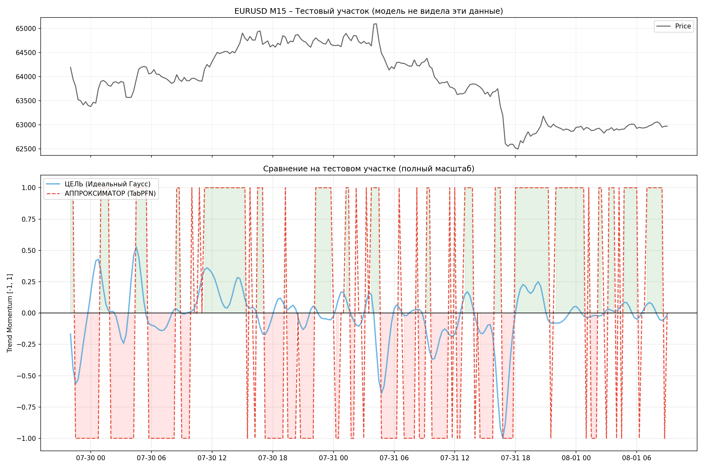 | 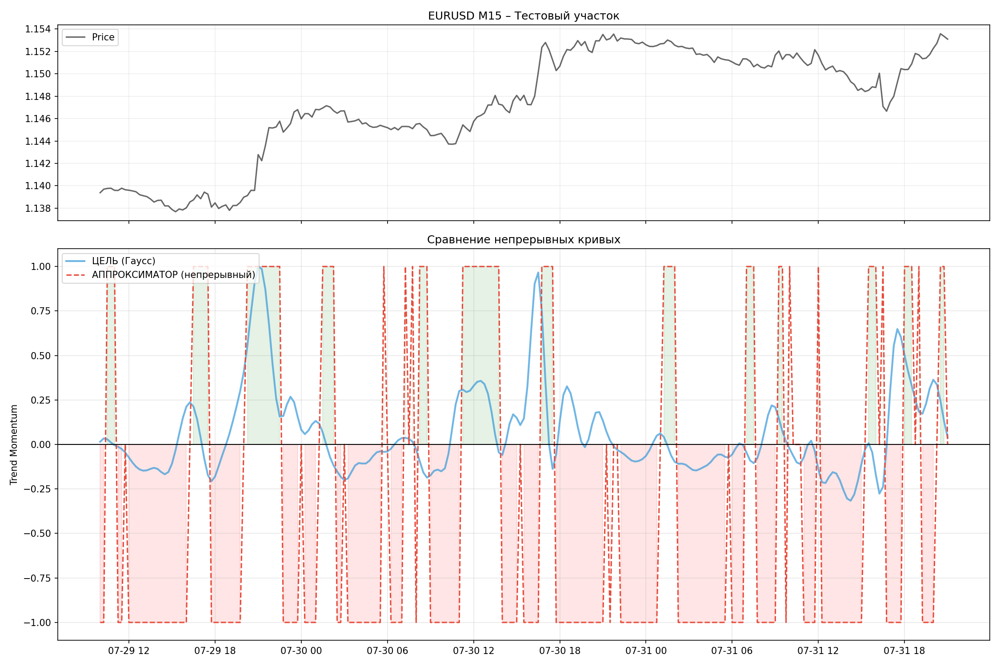 |

| Gaussian vs approx (smooth) | Gaussian vs probs (continuous) |
|---|---|
| 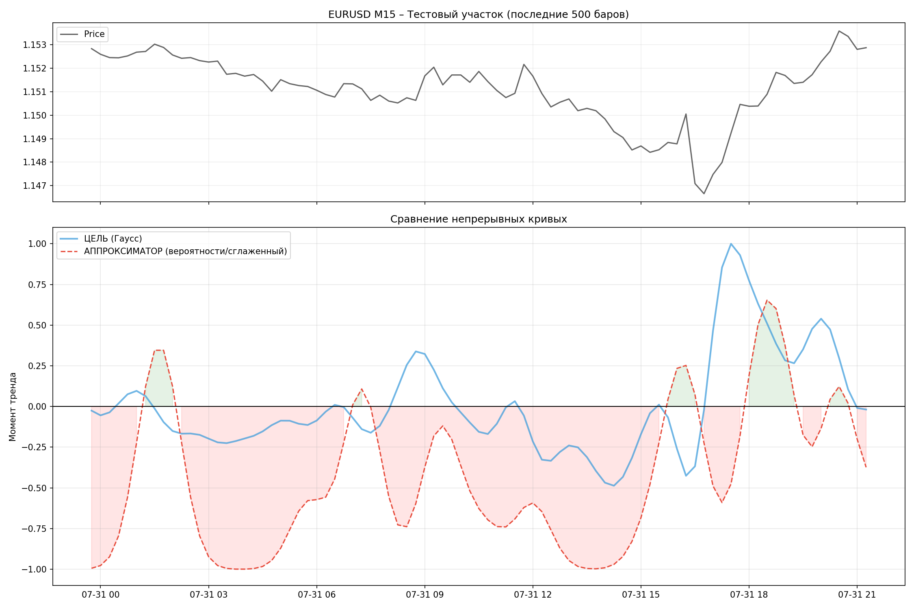 | 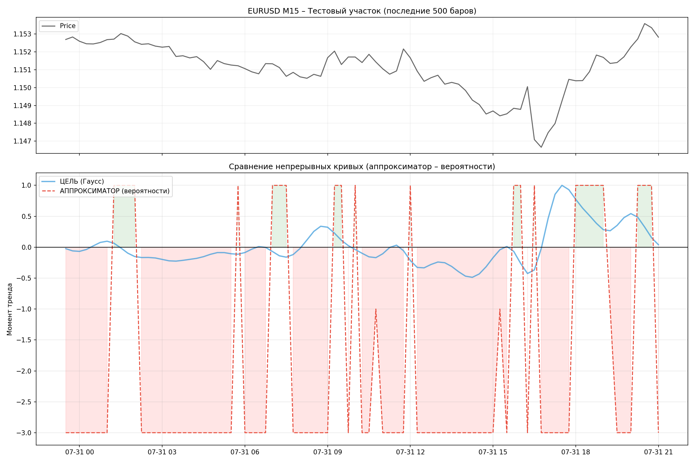 |

## 📁 Структура папок

| Путь | Назначение |
|------|------------|
| `strategy_logic.py` | боевая стратегия: CatBoost-аппроксиматор производной Гаусса + фичи |
| `fast_backtest.py` | движок бэктеста (спред, стоп по High/Low, таймаут) |
| `quantum_lab.py` | Optuna-оптимизация, `best_params.json`, `last_result.txt` |
| `quantum_boss.py` | автономный цикл: тест → Sharpe < 1.5 → вызов Aider для доработки |
| `bot_v8_final.py` | live-бот EURUSD M15 с контролем проскальзывания |
| `compare_models.py`, `test_equity.py`, `test_equity2.py` | сравнение моделей и проверка equity |
| `LightGBM-аппроксиматор*.py`, `TabPFN-аппроксиматор*.py` | экспериментальные аппроксиматоры учителя |
| `ai_studio_code.py`, `1.py`, `2.py` | вспомогательные/черновые скрипты |
| `ТЗ.txt` | техническое задание Aider (Head of Quant Research) |
| `best_params.json`, `start.bat` | параметры и запуск |
| `equity_*.png`, `Gaussian_vs_*.png`, `live_equity.png` | графики результатов и сравнений |
| `.aider.chat.history.md`, `.aider.input.history`, `.aider.tags.cache.v4` | история сессий Aider (в git не попадают) |

## 🚀 Запуск

```bash
pip install pandas numpy scipy scikit-learn lightgbm catboost optuna matplotlib MetaTrader5
python test_equity2.py           # проверка equity на данных MT5
python quantum_lab.py            # Optuna-оптимизация (Sharpe на train)
python bot_v8_final.py           # живой бот (нужен запущенный MT5)
python quantum_boss.py           # автономный цикл доработки через Aider
```

Нужен запущенный терминал MetaTrader 5 и установленный [Aider](https://aider.chat) для автономной доработки стратегии.

## ⬆️ Что не выгружено в репозиторий

Через `.gitignore` отсечены: `.aider*` (история чатов и кэши ассистента), `__pycache__/`.

---

> **ВНИМАНИЕ:** торговые системы с ML-компонентой — высокий риск. Результаты на исторических данных не гарантируют будущую прибыль. Проверяйте на демо.
